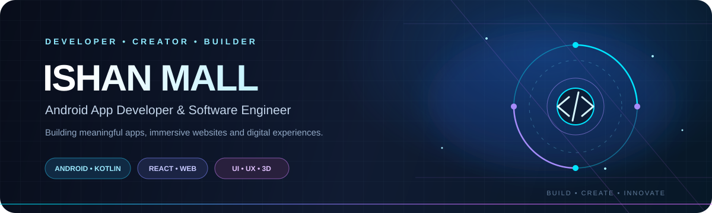

  

 

  
  
  
  
  
  
  

---

### 📱 Published Android Apps

<table>
  <tr>
    <td width="50%" valign="top">
      <h4>📸 <a href="https://play.google.com/store/apps/details?id=com.gallerybox">GalleryBox</a></h4>
      
Multi-domain multimedia platform combining Gallery, Stories, Trash lifecycles, Duo Music Player, Radio, and Video processing tools.

      <code>Kotlin</code> <code>Jetpack Compose</code> <code>Media3</code> <code>Room</code>
    </td>
    <td width="50%" valign="top">
      <h4>🌌 <a href="https://play.google.com/store/apps/details?id=com.brahmanda">Ananta Brahmanda</a></h4>
      
Spiritual & cosmic knowledge platform combining Vedic ephemeris with exact alarms, notifications, and persistent location services.

      <code>Kotlin</code> <code>SunCalc</code> <code>Location API</code> <code>WorkManager</code>
    </td>
  </tr>
  <tr>
    <td width="50%" valign="top">
      <h4>📄 <a href="https://play.google.com/store/apps/details?id=com.ishanmall.resumemaker">ResumeMakers</a></h4>
      
Offline Android resume creator utilizing Apache POI for Excel & document processing, local DB, and FileProvider export.

      <code>Kotlin</code> <code>Apache POI</code> <code>Room</code> <code>FileProvider</code>
    </td>
    <td width="50%" valign="top">
      <h4>📖 <a href="https://play.google.com/store/apps/details?id=com.anantagita">Ananta Gita</a></h4>
      
Multilingual Bhagavad Gita scripture reader covering all 18 Adhyayas with Sanskrit, Hindi, and English translations.

      <code>Kotlin</code> <code>Jetpack Compose</code> <code>Offline-First</code>
    </td>
  </tr>
  <tr>
    <td width="50%" valign="top">
      <h4>💧 <a href="https://play.google.com/store/apps/details?id=com.waterejector">Water Ejector</a></h4>
      
Offline Android speaker water-ejection utility with custom frequency audio, Jetpack Compose UI, and Lottie animations.

      <code>Kotlin</code> <code>Compose</code> <code>Lottie</code> <code>Audio</code>
    </td>
    <td width="50%" valign="top">
      <h4>🛠️ <a href="https://github.com/ishanmall/AnantaSanatan">Ananta Sanatan (In Lab)</a></h4>
      
Digital Sanatan knowledge Android app backed by Cloud Firestore, Room persistence, and Google Credential Manager.

      <code>Kotlin</code> <code>Compose</code> <code>Firestore</code> <code>Room</code>
    </td>
  </tr>
</table>

---

### 🌐 3D Websites & Chrome Extensions

<table>
  <tr>
    <td width="50%" valign="top">
      <h4>🪐 <a href="https://cosmic-codex-14559.web.app/">Cosmic Codex</a></h4>
      
3D astrophysical simulation suite (Black Holes, Neutron Stars) built on React Three Fiber & WebGL.

    </td>
    <td width="50%" valign="top">
      <h4>🏎️ <a href="https://portfolio-b1973.web.app/">Premium Portfolio 3D</a></h4>
      
Scroll-driven 3D racing-car portfolio with dynamic particles & bilingual English/Hindi voice narration.

    </td>
  </tr>
  <tr>
    <td width="50%" valign="top">
      <h4>🛕 <a href="https://mandir-dharshan.web.app/">Mandir Dharshan</a></h4>
      
Visual temple knowledge catalogue with structured local data, location search, and dark mode.

    </td>
    <td width="50%" valign="top">
      <h4>✨ <a href="https://who-is-god.web.app/">Who Is God?</a>  |  😄 <a href="https://gaystiny-a5016.web.app/">Gaystiny</a></h4>
      
Interactive Vedic philosophy platform & humorous animated prank questionnaire web app.

    </td>
  </tr>
  <tr>
    <td width="50%" valign="top">
      <h4>🧩 <a href="https://github.com/ishanmall/FacebookSwift">FacebookSwift</a></h4>
      
Manifest V3 Chrome Extension for Facebook.

    </td>
    <td width="50%" valign="top">
      <h4>🧩 <a href="https://github.com/ishanmall/WhatsAppSwift">WhatsAppSwift</a></h4>
      
Manifest V3 Chrome Extension for WhatsApp.

    </td>
  </tr>
</table>

---

### ⚡ Tech Stack

  

---

### 🏆 Certifications & Training (30+ Credentials)

<b>🛰️ NASA Certifications (7 Courses)</b>

* Fundamentals of Remote Sensing (Modules 1–4)
* Fundamentals of Remote Sensing for Air Quality Application (Modules 1–4)
* Hyperspectral Data for Land and Coastal Systems (Modules 1–3)
* Sustainable Earth Science Applications (Modules 1–3)
* NASA Open Science 101 & NASA Open Science Essentials
* Introduction to Satellite Remote Sensing for Air Quality Applications (ARSET Sessions 1–5)

<b>🌍 ISRO / IIRS Certifications (8 Courses)</b>

* Aerosols: Measurement, Retrieval and Impacts (WRF-Chem, CMAQ, GEOS-Chem, AERONET)
* AI/ML for Geodata Analysis (GeoAI, CNN, RNN, Foundation Models, LLMs & NLP)
* Climate Change Induced Disasters (Geospatial Technology Applications)
* Earth Observations & Tropical Cyclone Monitoring and Forecasting
* AI/ML for Hydroinformatics (Snow/Glacier Studies & Flood Forecasting)
* NISAR Applications (SAR Fundamentals, Polarimetric & Interferometric Analysis)
* Science Discussion (Vigyan Charcha)
* Basics of Remote Sensing, GIS and GNSS

<b>🏅 Google Developer, AI, Cisco & Awards</b>

* **Google Developer & Cloud (24 Badges):** Kotlin, Android Studio, Jetpack Compose, Room, DataStore, WorkManager, SQL, Navigation, Architecture Components
* **Android App Development & Android App Development with AI**
* **YUVA AI for ALL** (NASSCOM FutureSkills Prime) & **YUVA AI** (TCS iON)
* **Operating Systems Basics** — Cisco Networking Academy
* **Awards:** TATA Crucible Campus Quiz 2025, Puzzler's Pursuit (IIM Rohtak), VBYLD 2026

---

### 📊 Live GitHub Activity

  
  

